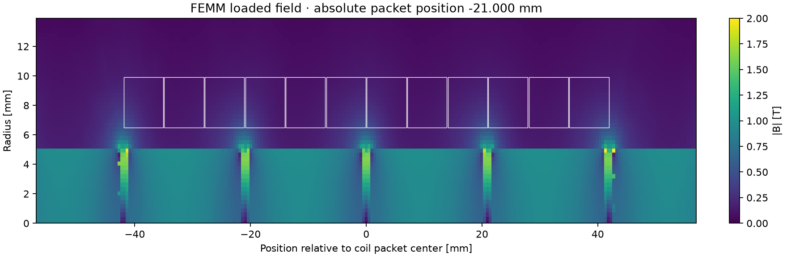

# FEMM Tubular Motor Simulator

A configurable Python/FEMM-Qt simulator for ironless tubular three-phase linear
motors. Describe the motor in a text file, watch FEMM solve the fields, and export
force curves, electrical results, thermal scenarios and a browser-readable report.



## Get started

1. Follow [Installation](docs/INSTALLATION.md) to install Python and FEMM 5.
2. Run `python motor_simulator.py --check` to create your local
   `motor_parameters.ini`, then edit it in a text editor.
3. Double-click `run_quick_test.bat` for a short visible test.
4. Use `start_simulation.bat` for the complete calculation.

The script prefers `.venv` inside this folder. The Windows launchers also support
an existing environment in the parent folder. Tested simulation platform:
64-bit Windows with FEMM 5 / FEMM-Qt and its `FemmSession` Python binding.

## What it calculates

- Axisymmetric loaded fields and force over electrical periods.
- Coil packing, copper mass, winding/line currents, DC copper losses and
  approximate voltage demand; ideal star/delta and parallel-branch conversion.
- Optional differential d/q inductance, mesh checks and stroke samples.
- Optional sixth-harmonic current correction, tested at new FEMM positions.
- Optional parametric thermal models and diagnostic opposing-field samples.
- PNG plots, CSV/JSON data, FEMM files and an HTML report for each run.

See the [User guide](docs/USAGE.md) and [6-, 9- and 12-coil examples](examples/README.md).

## Scope

This is a sequence of static field solutions, not a transient motion simulation.
Magnet/steel characteristics and cooling coefficients are assumptions until
verified against actual parts. Irreversible demagnetization, real PWM, controller
errors, 3D eccentricity and dynamic eddy-current losses are not modeled. Thermal
results do not qualify a cooling design or a safe continuous operating point.

## Tests

```powershell
python -m unittest discover -s . -p "test_*.py" -v
```

These tests check configuration and winding logic without FEMM or Python plotting
packages. GitHub Actions runs them on Windows and Linux; that does not establish
FEMM compatibility on Linux.

## License

**GNU GPL version 3 only (GPL-3.0-only)**; see [LICENSE](LICENSE). This covers the
simulator and its original documentation and example images. FEMM, its binding
and material libraries are installed separately and are not bundled. Dependencies
retain their own licenses. The software is provided without warranty under the
terms of the license.
