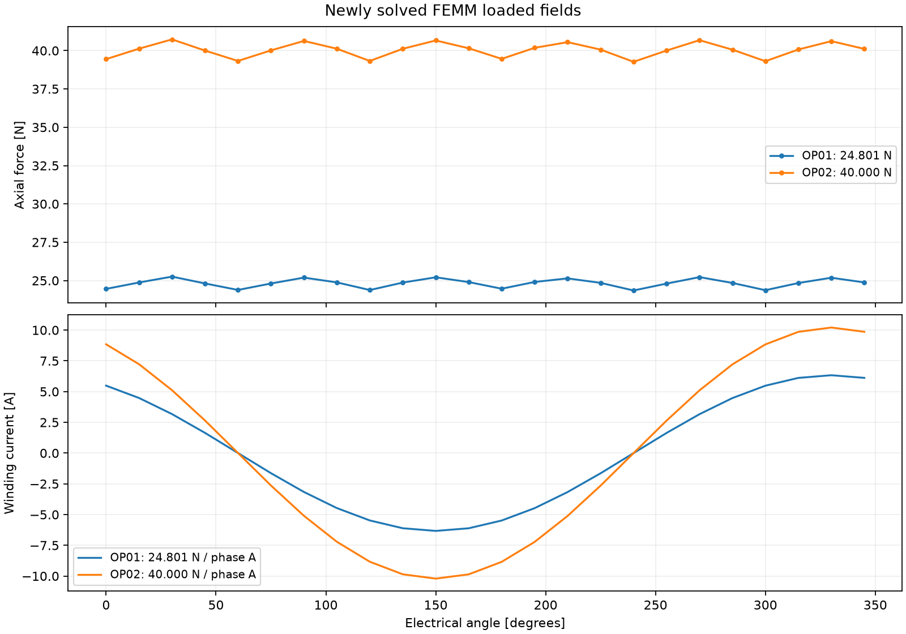

# Example configurations

All inputs are complete configurations, not overlays. The root
[`motor_parameters.example.ini`](../motor_parameters.example.ini) is the 12-coil
baseline. [`six_coils.ini`](six_coils.ini) and [`nine_coils.ini`](nine_coils.ini)
change only packet length and coil count. Every configuration recalculates its
own copper mass, total moving mass and automatic target force.

| Input | Coils | Pole pairs | Packet length | Copper mass |
|---|---:|---:|---:|---:|
| `six_coils.ini` | 6 | 1 | 42 mm | 39.18 g |
| `nine_coils.ini` | 9 | 1.5 | 63 mm | 58.76 g |
| Root example | 12 | 2 | 84 mm | 78.35 g |

Run an example from the repository folder:

```powershell
.\.venv\Scripts\python.exe motor_simulator.py examples\nine_coils.ini --visible
```

Relative output paths are resolved beside each INI; these two variants write to
`examples/Results/` by default. That directory is ignored by Git.

## Reference FEMM calculation

The reference plots use twelve coils, 72 turns per coil, winding ID 13 mm and OD
19.816 mm, 0.50 mm bare / 0.568 mm coated wire, N35 recoil assumptions and
Ø 10 × 19.5 mm magnets with Ø 10 × 1.5 mm steel spacers. Magnet and copper
reference temperatures are 60 °C. The electrical period is 42 mm; the rod contains
26 magnets with end reserve. Steel uses `1010 Steel (hot rolled)`.

A 24-position FEMM integration run produced approximately 24.83 N at 6.33 A winding
peak and 89.9 W DC copper loss at 60 °C for the acceleration target. This includes
285 g payload, an assumed 50 g additional moving hardware and calculated copper
mass. A separate 40 N point required approximately 10.21 A and 233.9 W.




A sixth-harmonic correction validated at twelve new positions reduced sampled
force ripple from approximately 2.88% to 0.47% in the reference calculation.
Sampling affects peak-to-peak estimates; the normal input uses 72 loaded positions
and 24 new validation positions. These results are model examples, not a
continuous-force, cooling or demagnetization qualification. Actual magnet and
steel data remain to be verified; see the [User guide](../docs/USAGE.md).
